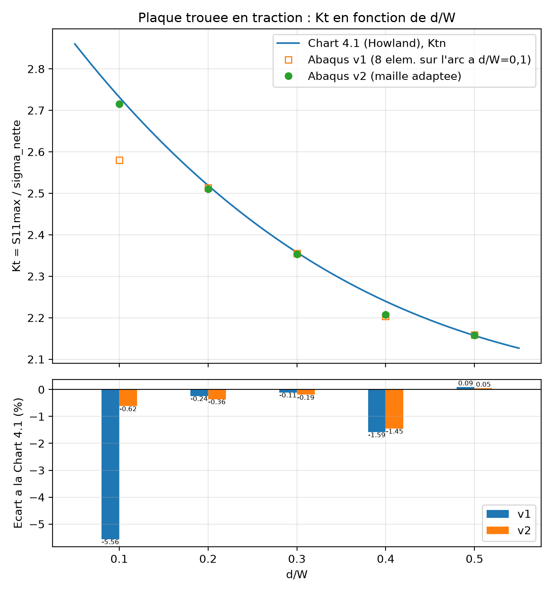

# Plaque trouée en traction : Kt sous Abaqus/Standard (script Python paramétré)

**Statut : en cours.** Projet en cours : modèle Abaqus paramétré d’une plaque trouée (script Python, balayage d/W, comparaison avec la Chart 4.1 de Peterson), HyperMesh et notions de fatigue à venir.

## Objectif
[2 phrases : calculer le facteur de concentration de contrainte Kt d'une plaque
trouée, valider contre une référence publiée, puis automatiser par script.
Lien avec le sujet de stage : modèle EF paramétrique et études de sensibilité.]

## Modèle
- Quart de plaque : symétrie en x = 0 (U1 = 0) et en y = 0 (U2 = 0)
- W = 100 mm, L = 3 W, t = 2 mm, trou centré de diamètre d
- Alliage d'aluminium, E = 71700 MPa, ν = 0.33
- CPS8R (contraintes planes), Static General, NLGEOM off
- Chargement : déplacement imposé U1 sur le bord x = L/2, U2 libre
- Kt = S11max / σ_nette, avec σ_nette = RF1 / ((W/2 − d/2)·t)
  (RF1 du quart de plaque, S11 aux nœuds sans moyenne)

## Référence
Peterson's Stress Concentration Factors, [auteur, édition], Chart 4.1, p. 256
(Howland) : Ktn = 2 + 0,284(1 − d/W) − 0,600(1 − d/W)² + 1,32(1 − d/W)³.
La formule de départ de mon plan s'en écarte de 0,5 % au plus.

## Validation (d/W = 0,2, trois maillages)
| Arc | Nœuds | RF1 (N) | Kt |
|---|---|---|---|
| 6 | 374 | 9 671,65 | 2,589 |
| 8 | 440 | 9 671,64 | 2,565 |
| 20 | 929 | 9 671,63 | 2,527 |

- RF1 identique à moins de 0,001 % : la statique est cohérente.
- Kt moyen → fin : −1,5 %. Le critère de 1 % n'est pas atteint.
  Cause : plafond de 1000 nœuds de l'édition étudiante.
- Ces 3 maillages n'ont pas la même zone fine que le script : ne pas les
  comparer directement au balayage ci-dessous.

## Balayage paramétrique (script `modele_plaque.py`)
[tableau du CSV v3 : d/W, arc, nœuds, Kt Abaqus, Kt Chart 4.1, écart]

- Écarts de −0,63 % à +0,07 %, sauf d/W = 0,4 : **−1,45 %**.
- d/W = 0,1 : −5,56 % avec 8 éléments sur l'arc (v1), −0,63 % avec 14 (v2).
  Pour un petit trou, le maillage de l'arc fait varier Kt de 5 %,
  alors que RF1 reste correct : la statique seule ne détecte pas ce défaut.
- d/W = 0,4 : stable entre n = 12 et 16 (Kt = 2,215 et 2,205) et vis-à-vis
  de la maille globale. Un test sur la zone fine est non concluant
  (deux paramètres ont changé). Cause non élucidée.

## Limites connues
- Warning « modified quadratic triangle » : [statut vérifié à l'étape 2]
- Pas de test de la longueur (L = 3 W contre 6 W) ni du type de charge
- Pas de balayage en épaisseur : en contraintes planes, Kt n'en dépend pas
- Plafond de 1000 nœuds
- Pas de matériau nommé

## Reproduire
1. Abaqus/CAE : `execfile('modele_plaque.py')`
2. `python trace_kt.py`

## À venir
- Même modèle dans HyperMesh
- Notes de fatigue (Wöhler, Kt, Kf)
